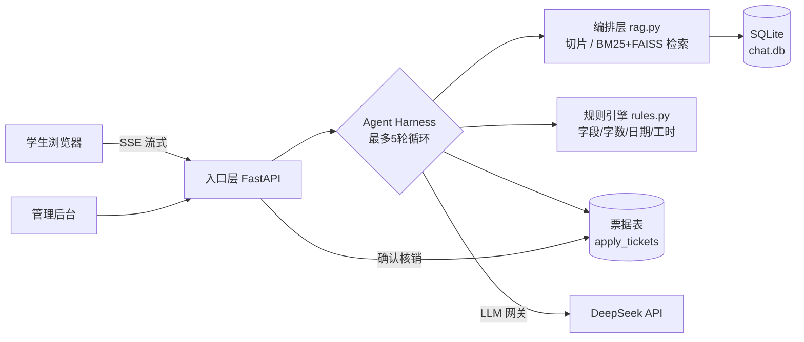

# 实习管理与教学助手（Intern Assistant）


基于 **RAG + Function Calling 智能体** 的实习管理与教学系统：学生用自然语言查询实习制度、提交请假/换岗/周报/日志申请，全程受**票据硬闸门**保护——AI 只能起草，不能替你提交。

## 为什么做这个

实习管理中，学生反复问相同制度问题、申请材料反复被打回、老师人工核对耗时。本项目用 AI 把"制度问答 + 申请办理"自动化，同时守住三条底线：

1. **不编造**：只依据制度文档原文回答，查不到就明确说"未找到相关规定"；
2. **可追溯**：每条回答附带文档来源，每次工具调用落 `agent_rounds` 日志；
3. **提交权在人**：AI 只能创建草稿，学生确认后才真正提交，且确认动作由服务端票据核销完成，模型无法代按。

## 功能总览

| 模块 | 能力 | 技术要点 |
|------|------|----------|
| 制度问答（RAG） | 上传制度文档 → 自动切片（约 500 字/片）→ 检索作答并附来源 | BM25(jieba) + FAISS 内积混合检索，无 embeddings 供应商时自动降级 BM25 |
| 智能体办申请 | 5 个工具：查制度 / 查实习信息 / 校验材料 / 创建草稿 / 查我的申请 | DeepSeek Function Calling，自建 Harness 最多 5 轮自收敛 |
| 硬闸门 | 草稿强制中断 → 学生确认 → 服务端核销提交 | 票据一次性 / 10 分钟过期 / 内容哈希绑定，伪造/篡改/重放一律拒绝 |
| 身份与隔离 | 学生学号登录，各看各的会话与申请单 | 独立 Cookie 令牌，越权访问 403；管理员查看记录留审计 |
| 管理后台 | 知识库上传/删除、问答记录、轮次轨迹、访问审计 | Jinja2 SSR，HttpOnly 会话，12 小时过期 |
| 安全防护 | 提示词注入检测、日志脱敏、LLM 配额限流 | 6 类注入特征留痕，手机号/身份证落日志前脱敏，10 次/分钟 + 100 次/天限流 |

## 系统架构



三层防线设计：**提示词纪律（软）→ 工具 Schema 必填（中）→ 服务端票据闸门（硬）**。模型无论怎么被引导，都不可能绕过确认接口替学生按下提交键。

## 快速开始

### 环境要求

- Python 3.10 ~ 3.12
- 一个 OpenAI 兼容的 Chat API Key（如 DeepSeek）

### 安装

```bash
git clone <本仓库地址>
cd intern-assistant
pip install -r requirements.txt
cp .env.example .env        # 填入你的 API Key
```

> 开发者可改用 `pip install -e ".[dev]"`，额外获得 pytest / ruff 工具链。

### 启动

```bash
# 方式一：Windows（cmd / 双击）
scripts\run.bat

# 方式二：Linux / macOS / Git Bash
bash scripts/run.sh

# 方式三：手动（任何平台）
set PYTHONPATH=src        # Windows；Linux/macOS 用 export PYTHONPATH=src
python -m intern_assistant.main
```

> 注意：Windows 的 `bash` 命令会调用 WSL（需安装 WSL2），没装 WSL 请用 `scripts\run.bat`。

浏览器打开 http://127.0.0.1:8000

- 学生端：`/student/login` 学号登录后进入聊天页（SSE 流式打字机）。**每个学生只能看到自己的会话与申请单。**
- 管理后台：`/login` → `/admin`。后台只做管理与督导，**不提供问答入口**；所有会话查看写入审计日志。

### 演示账号

| 角色 | 账号 | 密码 | 说明 |
|------|------|------|------|
| 学生 | 20230101 | 123456 | 张三 · 设备点检助理 |
| 学生 | 20230102 | 123456 | 李四 · 产线工艺助理 |
| 学生 | 20230103 | 123456 | 王五 · 质检助理 |
| 管理员 | admin | 见 `docs/deployment.md` | 首次启动种子账号，正式环境必须修改 |

> 正式环境请删除演示学生或强制改密；学生账号建议由教务系统批量导入。

## 配置说明

所有配置集中在 `.env`（参考 `.env.example`）：

| 变量 | 必填 | 说明 |
|------|------|------|
| `OPENAI_API_KEY` | 是 | OpenAI 兼容 Chat API 密钥（DeepSeek 实测可用） |
| `OPENAI_BASE_URL` | 否 | API 地址，默认 DeepSeek 官方 |
| `CHAT_MODEL` | 否 | 对话模型，默认 `deepseek-chat` |
| `IMS_DB_PATH` | 否 | SQLite 数据库路径，默认 `data/runtime/chat.db` |

非机密默认参数（轮数上限、票据有效期等）见 `config/default.yaml`。

## 测试与质量

```bash
make test          # 或 IMS_DB_PATH=/tmp/test.db pytest tests/
make lint          # ruff 静态检查（CI 同款规则）
```

71 条自动化测试，覆盖四个层面：

- **票据硬闸门对抗**（9 条）：伪造 / 篡改一字 / 重放 / 过期 / 换用户 / 换类型 / 预检不核销；
- **身份与数据隔离**（7 条）：跨学生读会话 / 续问 / 确认草稿全部 403，管理员不可代学生操作；
- **业务规则边界**（26 条）：30 天请假上限 / 周报 30 字 / 日志 50 字 / 工时 0~8 / 审批路由；
- **基础组件**（29 条）：脱敏、注入检测、相对日期解析、限流双窗口。

CI（GitHub Actions）在 Python 3.10 / 3.11 / 3.12 三个版本矩阵上执行 lint + 全量测试。评测方案与 30 条人工评测用例见 `docs/eval.md` 与 `data/eval_cases.json`。

## 目录结构

```
├── README.md            # 本文件
├── LICENSE              # MIT 许可证
├── CHANGELOG.md         # 版本记录
├── CONTRIBUTING.md      # 贡献指南（含 Conventional Commits 规范）
├── pyproject.toml       # 项目元数据 + ruff/pytest 工具链配置
├── requirements.txt     # Python 运行依赖
├── Makefile             # 常用命令速查（make help）
├── src/intern_assistant/
│   ├── main.py          # 程序入口
│   ├── core/
│   │   ├── app.py       # 服务层：路由 + 闸门 + Agent Harness
│   │   ├── rag.py       # 编排层：切片 / 混合检索 / LLM 网关
│   │   ├── rules.py     # 业务规则引擎：申请材料合规判定
│   │   ├── prompts.py   # 系统提示词集中管理
│   │   └── rate_limit.py# LLM 配额限流器
│   ├── templates/       # 管理后台页面（Jinja2 SSR）
│   ├── static/          # 学生端聊天页
│   └── utils/           # 脱敏 / 注入检测 / 文本工具
├── docs/                # design / api / testing / deployment / security / eval
├── tests/               # pytest（与 src 结构对应）
├── examples/            # 跑得起来的 demo
├── scripts/             # 启动 / 初始化脚本（run.bat / run.sh / init_db.py）
├── config/              # 非机密默认配置
├── data/                # 样例制度文档、30 条评测用例
└── .github/             # CI / Issue / PR 模板 / pre-commit
```

## 常见问题（FAQ）

**Q：为什么 AI 不能直接帮我提交申请？**
A：设计如此。制度上申请是学生的法律意思表示，必须本人确认。系统层面用"草稿中断 + 票据核销"保证模型永远碰不到提交按钮——这也是对提示词注入攻击的结构性防御。

**Q：查不到的问题 AI 会瞎编吗？**
A：不会。系统提示词固化"查不到拒答"纪律，回答必须附文档来源；对应 3 条陷阱评测用例（宠物托管、请假驳回三倍工资等）验证拒答行为。

**Q：检索用的向量模型在哪？**
A：DeepSeek 暂无 embeddings 接口，系统自动降级为 BM25 关键词检索；配置任一 OpenAI 兼容 embeddings 服务后自动启用混合检索，无需改代码。

**Q：多个学生同时用会串数据吗？**
A：不会。会话、申请单全部绑定登录身份，读/续问/确认他人数据一律 403；有 7 条自动化隔离测试持续守护。

**Q：Windows 下 `bash scripts/run.sh` 报 Hyper-V 错误？**
A：Windows 的 `bash` 会调用 WSL。未安装 WSL2 时请直接用 `scripts\run.bat`。

**Q：API Key 泄漏了怎么办？**
A：立即在供应商后台吊销并更换 `.env`。仓库通过 pre-commit 的 detect-private-key 钩子和 `.gitignore` 双重防护，历史提交可用 `git log -S "sk-"` 自查。

## Roadmap

- [ ] 向量检索接入（硅基流动 embeddings，已预留 `llm_embed` 接口）
- [ ] 管理后台轮次轨迹分析页（慢查询 / 高频问题统计）
- [ ] 教务系统对接（学生账号与实习档案批量同步）
- [ ] PostgreSQL + pgvector 迁移（多实例部署）
- [ ] 企业微信 / 钉钉通知（草稿待确认提醒）

## 安全须知

- `.env` 含 API Key，已被 `.gitignore` 排除，**切勿提交或分享**
- `data/runtime/` 存放运行期数据库与上传文档，同样不入库
- 三条问答纪律已固化在系统提示词：查不到拒答 / 回答必附文档名 / 不编造规则
- 安全设计详见 `docs/security.md`

## License

[MIT](LICENSE)
